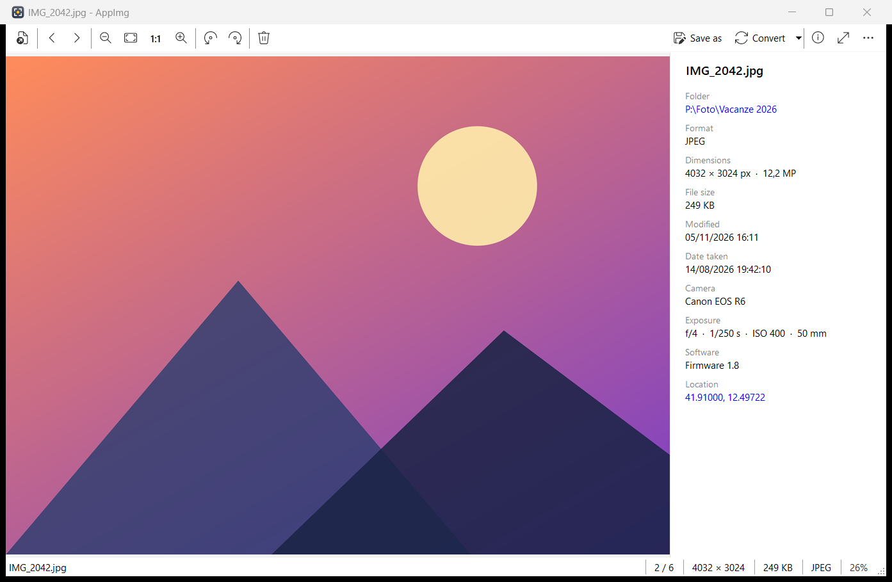

<h1 align="center">AppImg</h1>

<p align="center">
  Visualizzatore di immagini per Windows, leggero e veloce, con convertitore integrato.<br>
  Apre JPEG, PNG, HEIC, WebP, AVIF, TIFF, GIF animate, RAW e altri; salva in PNG, JPEG, WebP, HEIC, TIFF, BMP, GIF, JPEG XR, ICO o PDF.<br>
  <a href="#english">English below</a>
</p>

<p align="center">
  <a href="https://github.com/corbolma/AppImg/releases/latest"><b>⬇ Scarica l'ultima versione</b></a> ·
  <a href="https://github.com/corbolma/AppImg/issues">Segnala un problema</a>
</p>

<p align="center">
  
</p>
<p align="center"><sub>Il visualizzatore con il pannello informazioni (immagini di esempio)</sub></p>

---

## Italiano

### Visualizzatore
- **Apri un'immagine e scorri le altre** della stessa cartella con le frecce ← →, i tasti laterali del mouse o le frecce che compaiono ai lati della finestra.
- **Zoom** con la rotellina (attorno al punto indicato dal mouse), *Adatta alla finestra*, *Dimensioni reali*; trascina per spostarti nelle immagini grandi; doppio clic per passare da adattata a 100%.
- **Rotazione**, **schermo intero** (F11) e **presentazione** (F5).
- **Pannello informazioni** (I): formato, dimensioni, peso, data dello scatto, fotocamera, esposizione (diaframma, tempo, ISO, focale) e posizione GPS con link alla mappa.
- **GIF animate** riprodotte, **trasparenza** mostrata su sfondo a scacchi, **foto dritte** secondo l'orientamento EXIF del telefono.
- **Copia** (Ctrl+C) l'immagine per incollarla in un altro programma o il file in Esplora file; **Sposta nel Cestino** (Canc).
- Le immagini vicine vengono preparate in anticipo, così il passaggio da una all'altra è immediato.

### Convertitore
- **Salva come** (Ctrl+S): salva l'immagine aperta in un altro formato, con la rotazione applicata.
- **Converti** (Ctrl+E): una finestra per convertire **molte immagini insieme**: questa, tutte quelle della cartella, oppure file e cartelle trascinati dentro. Qualità regolabile (JPEG, JPEG XR, PDF), riduzione opzionale (lato lungo massimo, larghezza × altezza con o senza proporzioni bloccate, oppure percentuale; le immagini non vengono mai ingrandite), cartella di destinazione a scelta. Mentre cambi formato, qualità o riduzione, la colonna **Previsto** mostra il peso che avrà ogni file e in basso compare il **totale previsto** rispetto a quello attuale (es. *≈ 711 KB, ora 6,4 MB, −89%*): le immagini vengono codificate davvero in memoria, quindi la stima coincide con il risultato.
- Formati in uscita: PNG, JPEG, TIFF, BMP, GIF, JPEG XR, **ICO** (icona da 16 a 256 px) e **PDF** (una pagina per immagine). **WebP** e **HEIC** compaiono se sul PC è installato il relativo encoder.
- La trasparenza resta nei formati che la supportano; negli altri diventa bianca. L'originale non viene mai sovrascritto: se il file esiste viene creato `foto (1).png`, salvo scelta diversa.
- Da Esplora file: seleziona le immagini → tasto destro → **Invia a → AppImg** apre direttamente il convertitore.

<p align="center"></p>

### Griglia IA
Il pulsante **Griglia IA** (tasto **G**) divide l'immagine come una scacchiera: colonne A, B, C... e righe 1, 2, 3..., quindi ogni riquadro ha un nome (A1 è in alto a sinistra). Scegli il numero di colonne e righe, clicca un riquadro e:
- **Migliora con IA**: lo ingrandisce ×2, ×3 o ×4 con [Real-ESRGAN](https://github.com/xinntao/Real-ESRGAN), una rete neurale che ricostruisce i dettagli invece di sfocare. Modelli *Foto*, *Disegni e grafica* e *Veloce*. Gira **sul PC** con la scheda video (vanno bene anche le grafiche integrate Intel/AMD con driver Vulkan): le immagini non escono dal computer.
- **Salva riquadro**: salva solo quel riquadro (la versione migliorata, se c'è), con un nome come `foto_F3_x4.png`.
- **Suddividi riquadro** (doppio clic o Invio): il riquadro diventa una nuova scacchiera da dividere di nuovo, e così via in profondità (`foto_F3-B2_x4.png`). **Indietro** (Backspace) torna al livello precedente.

**Assistente**: scrivi cosa vuoi fare e lo fa lui, comandando Real-ESRGAN: *«migliora F3 e salvalo in JPEG»*, *«dividi in 4×4 e zooma su B2»*, *«trova la targa e rendila leggibile»*. Vede la scacchiera (ridotta, con le etichette), sceglie i riquadri, li migliora, li apre, cambia griglia e salva accanto all'originale; nel riquadro di dialogo scrive cosa ha fatto. Servizi: **Claude Code** (abbonamento Claude, nessuna chiave: è quello predefinito), **Claude** (API Anthropic, con chiave) o un servizio **compatibile OpenAI** con un modello che vede le immagini (OpenAI, OpenRouter, Ollama, LM Studio...). Le chiavi sono cifrate con DPAPI di Windows.

Real-ESRGAN non è incluso nell'installer: al primo miglioramento AppImg chiede il permesso e lo scarica dalla release ufficiale su GitHub (~45 MB, una sola volta), ne verifica lo SHA-256 e lo mette in `%LOCALAPPDATA%\AppImg\realesrgan` (la disinstallazione lo rimuove).

### Formati letti
AppImg usa i codec di Windows: legge BMP, PNG, JPEG, GIF, TIFF, ICO, JPEG XR e, con le estensioni gratuite del Microsoft Store, anche **HEIC/HEIF** (foto di iPhone), **WebP**, **AVIF**, **JPEG XL** e i **RAW** delle fotocamere (CR2, CR3, NEF, ARW, DNG, ORF, RW2...). Se un'immagine non si apre, installa l'estensione corrispondente: *Estensioni immagine HEIF* (con *Estensioni video HEVC*), *Estensioni immagine WebP*, *Estensione video AV1*, *Raw Image Extension*.

### Tasti
| Tasto | Azione | Tasto | Azione |
|---|---|---|---|
| ← → · PagSu PagGiù · Spazio | immagine precedente / successiva | Ctrl+O | apri |
| Home · Fine | prima / ultima | Ctrl+S | salva come |
| + − · rotellina | zoom | Ctrl+E | converti |
| 0 · 1 | adatta · dimensioni reali | Ctrl+C | copia |
| R · Shift+R | ruota a destra / sinistra | Canc | sposta nel Cestino |
| F11 · F · Esc | schermo intero | I | informazioni |
| F5 | presentazione | Ctrl+W | chiudi |
| G | griglia IA | | |

### Installazione
1. Scarica `AppImg-Setup-X.Y.Z.exe` dalle [Releases](https://github.com/corbolma/AppImg/releases/latest).
2. Avvialo. **Non servono permessi di amministratore**: installa solo per l'utente corrente.
3. Se compare *"Windows ha protetto il PC"*, clicca **Ulteriori informazioni → Esegui comunque** (l'eseguibile non è firmato digitalmente).
4. Per aprire le immagini con AppImg con un doppio clic: al termine dell'installazione rispondi **Sì** e scegli AppImg in *Impostazioni → App predefinite* (Windows non permette ai programmi di farlo da soli). Si può fare anche dopo, dal menu **⋯ → Imposta come visualizzatore predefinito**, oppure con tasto destro su un'immagine → *Apri con* → *Scegli un'altra app* → AppImg → *Sempre*.

Installazione silenziosa (per l'IT): `AppImg-Setup-X.Y.Z.exe /silent` · Disinstallazione: Impostazioni → App, oppure `"%LOCALAPPDATA%\Programs\AppImg\Uninstall.exe" /uninstall /silent`.

Dal menu **⋯**: lingua (italiano e inglese, segue quella di Windows; altre lingue si aggiungono con un file di testo, vedi [lang/README.md](lang/README.md)), **aggiornamenti** (*Controlla aggiornamenti* scarica l'installer dalle Releases e ne verifica lo SHA-256; il controllo automatico giornaliero è disattivato di default) e *Informazioni su AppImg*.

### Compilare dal sorgente
Non serve installare nulla: si usa il compilatore C# incluso in Windows (.NET Framework 4.x).

```bat
build.bat                      :: crea AppImg.exe
build-installer.bat            :: crea dist\AppImg-Setup-X.Y.Z.exe
build-installer.bat patch      :: incrementa la versione (1.0.0 -> 1.0.1) e crea l'installer
```

### Privacy
AppImg non raccoglie dati e lavora solo sul tuo PC: le immagini non vengono mai inviate da nessuna parte. Le connessioni sono solo: il controllo degli aggiornamenti (`api.github.com`), quando lo chiedi o se attivi quello automatico; il download di Real-ESRGAN da GitHub, una volta e dopo la tua conferma; e, nella Griglia IA, le richieste all'**assistente** che hai scelto, che riceve il testo che scrivi e, se lo lasci attivo nelle impostazioni, la scacchiera ridotta (il miglioramento dei riquadri invece resta sul PC); il link della posizione GPS apre OpenStreetMap solo se ci clicchi. I metadati (EXIF, posizione GPS...) **non** vengono copiati nei file convertiti.

---

## English

<p align="center"></p>

**AppImg** is a fast, lightweight image viewer for Windows 10/11 with a built-in converter.

- **View:** open an image and browse the rest of its folder with ← →, the mouse side buttons or the on-screen arrows. Mouse-wheel zoom around the cursor, fit to window, actual size, drag to pan, rotate, full screen (F11), slideshow (F5). Animated GIFs play, transparency is shown on a checkerboard, phone photos are shown upright (EXIF orientation).
- **Info panel** (I): format, dimensions, file size, date taken, camera, exposure (aperture, shutter, ISO, focal length) and GPS location with a map link.
- **Convert:** *Save as* (Ctrl+S) saves the current image in another format with the rotation applied; *Convert* (Ctrl+E) opens a batch converter for this image, the whole folder, or any files and folders you drop in — with quality, optional downscaling and destination folder. While you change format, quality or size, an **Estimated** column shows each file's new size and the status bar shows the estimated total vs. the current one (images are actually encoded in memory, so the estimate matches the result). File Explorer → right-click → **Send to → AppImg** opens the converter directly.
- **Reads** anything Windows can decode: BMP, PNG, JPEG, GIF, TIFF, ICO, JPEG XR, plus **HEIC/HEIF**, **WebP**, **AVIF**, **JPEG XL** and camera **RAW** when the free Microsoft Store extensions are installed. **Writes** PNG, JPEG, TIFF, BMP, GIF, JPEG XR, **ICO** (16–256 px) and **PDF**; **WebP** and **HEIC** when the matching encoder is installed. The original is never overwritten.
- **AI grid** (G): divides the image like a chessboard (columns A, B, C..., rows 1, 2, 3...). Each tile can be **enhanced** ×2/×3/×4 with [Real-ESRGAN](https://github.com/xinntao/Real-ESRGAN) running locally on the GPU (integrated Intel/AMD graphics with Vulkan drivers work too), **saved** on its own, or **subdivided** into a new grid, again and again. An **assistant** drives it from plain requests (*"enhance F3 and save it"*, *"find the plate and make it readable"*): **Claude Code** (Claude subscription, no key, default), **Claude** (Anthropic API key) or any **OpenAI-compatible** vision model. Real-ESRGAN (BSD-3-Clause) is downloaded from its official GitHub release on first use after asking (~45 MB, SHA-256 verified) into `%LOCALAPPDATA%\AppImg\realesrgan`.
- **Install:** download `AppImg-Setup-X.Y.Z.exe` from [Releases](https://github.com/corbolma/AppImg/releases/latest). Per-user install, no admin rights required; it registers AppImg in *Open with* and *Default apps* (Windows lets only the user pick the default app: answer *Yes* at the end of setup, or use menu **⋯ → Set as default image viewer**). The executable is not code-signed, so SmartScreen may ask you to confirm (*More info → Run anyway*). Silent install: `/silent`.
- **Updates:** menu ⋯ → *Check for updates* downloads the installer from GitHub Releases and verifies its SHA-256. Automatic daily check is off by default.
- **Build:** run `build-installer.bat` — it uses the C# compiler bundled with Windows (.NET Framework 4.x), no SDK needed.
- **Privacy:** no telemetry. Outbound requests: the update check (`api.github.com`), the one-time Real-ESRGAN download after you confirm, and in the AI grid the assistant you chose, which gets your text and, unless you turn it off, a reduced view of the grid. Tile enhancement always runs on your PC. Metadata is not copied to converted files.

The user interface is available in **English and Italian**: it follows the Windows display language and can be changed from menu ⋯ → *Lingua / Language*.
**Translations are welcome**: adding a language is just a text file, no coding required — see [lang/README.md](lang/README.md).

## License

[MIT](LICENSE) © 2026 Mauro Corboli

Third-party component, downloaded on first use and not bundled: [Real-ESRGAN ncnn-vulkan](https://github.com/xinntao/Real-ESRGAN) by Xintao Wang et al., BSD-3-Clause.
