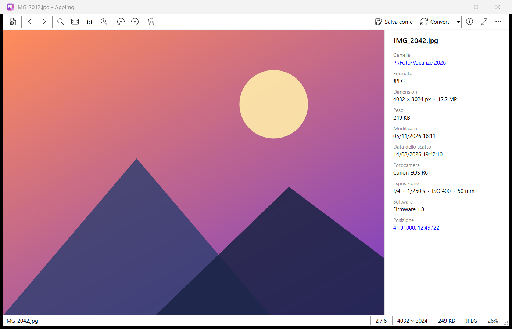
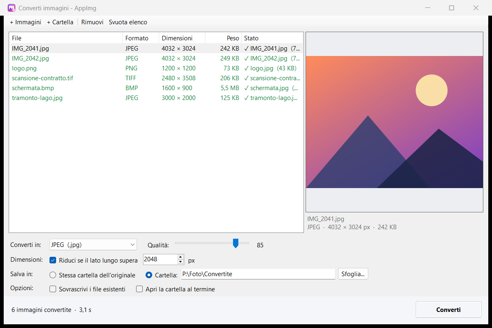

<h1 align="center">CorbolImg</h1>

<p align="center"><sub>Prima si chiamava <b>AppImg</b> (fino alla versione 1.3.0): chi ha già installato la versione vecchia riceve CorbolImg con l'aggiornamento automatico, con impostazioni e dati.<br>Formerly <b>AppImg</b> (up to version 1.3.0): existing installations get CorbolImg through the automatic update, keeping settings and data.</sub></p>

<p align="center">
  Visualizzatore di immagini per Windows, leggero e veloce, con convertitore integrato.<br>
  Apre JPEG, PNG, HEIC, WebP, AVIF, TIFF, GIF animate, RAW e altri; salva in PNG, JPEG, WebP, HEIC, TIFF, BMP, GIF, JPEG XR, ICO o PDF.<br>
  <a href="#english">English below</a> · <a href="https://github.com/corbolma/CorbolImg/wiki">Wiki</a>
</p>

<p align="center">
  <a href="https://github.com/corbolma/CorbolImg/releases/latest"><b>⬇ Scarica l'ultima versione</b></a> ·
  <a href="https://github.com/corbolma/CorbolImg/issues">Segnala un problema</a>
</p>

<p align="center">
  
</p>
<p align="center"><sub>Il visualizzatore con il pannello informazioni (immagini di esempio)</sub></p>

---

## Italiano

### Visualizzatore
- **Apri un'immagine e scorri le altre** della stessa cartella con le frecce ← →, i tasti laterali del mouse o le frecce che compaiono ai lati della finestra.
- **Zoom** con la rotellina (attorno al punto indicato dal mouse), *Adatta alla finestra*, *Dimensioni reali*; trascina per spostarti nelle immagini grandi; doppio clic per passare da adattata a 100%.
- **Rotazione**, **schermo intero** (F11) e **presentazione** (F5).
- **Pannello informazioni** (I): formato, dimensioni, peso, data dello scatto, fotocamera, esposizione (diaframma, tempo, ISO, focale) e posizione GPS con link alla mappa.
- **GIF animate** riprodotte, **trasparenza** mostrata su sfondo a scacchi, **foto dritte** secondo l'orientamento EXIF del telefono.
- **Copia** (Ctrl+C) l'immagine per incollarla in un altro programma o il file in Esplora file; **Sposta nel Cestino** (Canc).
- Le immagini vicine vengono preparate in anticipo, così il passaggio da una all'altra è immediato.

### Convertitore
- **Salva come** (Ctrl+S): salva l'immagine aperta in un altro formato, con la rotazione applicata.
- **Converti** (Ctrl+E): una finestra per convertire **molte immagini insieme**: questa, tutte quelle della cartella, oppure file e cartelle trascinati dentro. Qualità regolabile (JPEG, JPEG XR, PDF), riduzione opzionale (lato lungo massimo, larghezza × altezza con o senza proporzioni bloccate, oppure percentuale; le immagini non vengono mai ingrandite), cartella di destinazione a scelta. Mentre cambi formato, qualità o riduzione, la colonna **Previsto** mostra il peso che avrà ogni file e in basso compare il **totale previsto** rispetto a quello attuale (es. *≈ 711 KB, ora 6,4 MB, −89%*): le immagini vengono codificate davvero in memoria, quindi la stima coincide con il risultato.
- Formati in uscita: PNG, JPEG, TIFF, BMP, GIF, JPEG XR, **ICO** (icona da 16 a 256 px) e **PDF** (una pagina per immagine). **WebP** e **HEIC** compaiono se sul PC è installato il relativo encoder.
- La trasparenza resta nei formati che la supportano; negli altri diventa bianca. L'originale non viene mai sovrascritto: se il file esiste viene creato `foto (1).png`, salvo scelta diversa.
- Da Esplora file: seleziona le immagini → tasto destro → **Invia a → CorbolImg** apre direttamente il convertitore.

<p align="center"></p>

### Griglia IA
Il pulsante **Griglia IA** (tasto **G**) divide l'immagine come una scacchiera: colonne A, B, C... e righe 1, 2, 3..., quindi ogni riquadro ha un nome (A1 è in alto a sinistra). Scegli il numero di colonne e righe, clicca un riquadro e:
- **Migliora con IA**: lo ingrandisce ×2, ×3 o ×4 con [Real-ESRGAN](https://github.com/xinntao/Real-ESRGAN), una rete neurale che ricostruisce i dettagli invece di sfocare. Modelli *Foto*, *Disegni e grafica* e *Veloce*. Gira **sul PC** con la scheda video (vanno bene anche le grafiche integrate Intel/AMD con driver Vulkan): le immagini non escono dal computer.
- **Salva riquadro**: salva solo quel riquadro (la versione migliorata o ritoccata, se c'è), con un nome come `foto_F3_x4.png`.
- **Suddividi riquadro** (doppio clic o Invio): il riquadro diventa una nuova scacchiera da dividere di nuovo, e così via in profondità (`foto_F3-B2_x4.png`). **Indietro** (Backspace) torna al livello precedente.

**Assistente**: scrivi cosa vuoi fare e lo fa lui, comandando Real-ESRGAN: *«migliora F3 e salvalo in JPEG»*, *«dividi in 4×4 e zooma su B2»*, *«trova la targa e rendila leggibile»*. Vede la scacchiera (ridotta, con le etichette), sceglie i riquadri, li migliora, li apre, cambia griglia e salva accanto all'originale; nel riquadro di dialogo scrive cosa ha fatto. Servizi: **Claude Code** (abbonamento Claude, nessuna chiave: è quello predefinito), **Claude** (API Anthropic, con chiave) o un servizio **compatibile OpenAI** con un modello che vede le immagini (OpenAI, OpenRouter, Ollama, LM Studio...). Le chiavi sono cifrate con DPAPI di Windows. Il pulsante 🎤 accanto a **Invia** apre la dettatura vocale di Windows (Win+H) per dettare la richiesta invece di scriverla.

**Ritocchi** (chiedendoli all'assistente): luminosità, contrasto, saturazione, colori più caldi o freddi, livelli automatici (foto spente o con una dominante), bianco e nero, seppia, nitidezza, riduzione del rumore, sfocatura, pixel grossi (per coprire targhe e volti), rotazione o raddrizzamento di pochi gradi e specchio. Per esempio *«schiarisci B2 e aumenta un po' il contrasto»*, *«copri la targa in D4»*, *«raddrizza l'orizzonte»*. Si fanno sul PC senza scaricare niente, anche solo su una zona del riquadro, e si possono annullare uno alla volta (*«annulla l'ultimo ritocco di B2»*) o tutti (*«riporta B2 all'originale»*). I riquadri ritoccati compaiono nella scacchiera con il segno **R**, entrano nel salvataggio dell'immagine intera (oto_mod.png) e, se li fai dentro un riquadro aperto, tornando indietro passano al riquadro di partenza. Per ritoccare tutta la foto l'assistente usa una griglia 1×1.

Real-ESRGAN non è incluso nell'installer: al primo miglioramento CorbolImg chiede il permesso e lo scarica dalla release ufficiale su GitHub (~45 MB, una sola volta), ne verifica lo SHA-256 e lo mette in `%LOCALAPPDATA%\CorbolImg\realesrgan` (la disinstallazione lo rimuove).

### Formati letti
CorbolImg usa i codec di Windows: legge BMP, PNG, JPEG, GIF, TIFF, ICO, JPEG XR e, con le estensioni gratuite del Microsoft Store, anche **HEIC/HEIF** (foto di iPhone), **WebP**, **AVIF**, **JPEG XL** e i **RAW** delle fotocamere (CR2, CR3, NEF, ARW, DNG, ORF, RW2...). Se un'immagine non si apre, installa l'estensione corrispondente: *Estensioni immagine HEIF* (con *Estensioni video HEVC*), *Estensioni immagine WebP*, *Estensione video AV1*, *Raw Image Extension*.

### Tasti
| Tasto | Azione | Tasto | Azione |
|---|---|---|---|
| ← → · PagSu PagGiù · Spazio | immagine precedente / successiva | Ctrl+O | apri |
| Home · Fine | prima / ultima | Ctrl+S | salva come |
| + − · rotellina | zoom | Ctrl+E | converti |
| 0 · 1 | adatta · dimensioni reali | Ctrl+C | copia |
| R · Shift+R | ruota a destra / sinistra | Canc | sposta nel Cestino |
| F11 · F · Esc | schermo intero | I | informazioni |
| F5 | presentazione | Ctrl+W | chiudi |
| G | griglia IA | | |

### Installazione
1. Scarica `CorbolImg-Setup-X.Y.Z.exe` dalle [Releases](https://github.com/corbolma/CorbolImg/releases/latest).
2. Avvialo. **Non servono permessi di amministratore**: installa solo per l'utente corrente.
3. Se compare *"Windows ha protetto il PC"*, clicca **Ulteriori informazioni → Esegui comunque** (l'eseguibile non è firmato digitalmente).
4. Per aprire le immagini con CorbolImg con un doppio clic: al termine dell'installazione rispondi **Sì** e scegli CorbolImg in *Impostazioni → App predefinite* (Windows non permette ai programmi di farlo da soli). Si può fare anche dopo, dal menu **⋯ → Imposta come visualizzatore predefinito**, oppure con tasto destro su un'immagine → *Apri con* → *Scegli un'altra app* → CorbolImg → *Sempre*.

Installazione silenziosa (per l'IT): `CorbolImg-Setup-X.Y.Z.exe /silent` · Disinstallazione: Impostazioni → App, oppure `"%LOCALAPPDATA%\Programs\CorbolImg\Uninstall.exe" /uninstall /silent`.

Dal menu **⋯**: lingua (italiano e inglese, segue quella di Windows; altre lingue si aggiungono con un file di testo, vedi [lang/README.md](lang/README.md)), **aggiornamenti** (*Controlla aggiornamenti* scarica l'installer dalle Releases e ne verifica lo SHA-256; il controllo automatico giornaliero è disattivato di default) e *Informazioni su CorbolImg*.

### Compilare dal sorgente
Non serve installare nulla: si usa il compilatore C# incluso in Windows (.NET Framework 4.x).

```bat
build.bat                      :: crea CorbolImg.exe
build-installer.bat            :: crea dist\CorbolImg-Setup-X.Y.Z.exe
build-installer.bat patch      :: incrementa la versione (1.0.0 -> 1.0.1) e crea l'installer
```

### Privacy
CorbolImg non raccoglie dati e lavora solo sul tuo PC: le immagini non vengono mai inviate da nessuna parte. Le connessioni sono solo: il controllo degli aggiornamenti (`api.github.com`), quando lo chiedi o se attivi quello automatico; il download di Real-ESRGAN da GitHub, una volta e dopo la tua conferma; e, nella Griglia IA, le richieste all'**assistente** che hai scelto, che riceve il testo che scrivi e, se lo lasci attivo nelle impostazioni, la scacchiera ridotta (il miglioramento dei riquadri invece resta sul PC); il link della posizione GPS apre OpenStreetMap solo se ci clicchi. La dettatura (🎤) è quella di Windows: CorbolImg non accede al microfono, il riconoscimento vocale lo gestisce Windows secondo le sue impostazioni. I metadati (EXIF, posizione GPS...) **non** vengono copiati nei file convertiti.

---

## English

<p align="center"></p>

**CorbolImg** is a fast, lightweight image viewer for Windows 10/11 with a built-in converter. It opens JPEG, PNG, HEIC, WebP, AVIF, TIFF, animated GIF, RAW and more; it saves to PNG, JPEG, WebP, HEIC, TIFF, BMP, GIF, JPEG XR, ICO or PDF. Full documentation: [wiki (English)](https://github.com/corbolma/CorbolImg/wiki/English).

### Viewer
- **Open an image and browse the others** in the same folder with the ← → keys, the mouse side buttons or the arrows that appear at the sides of the window.
- **Zoom** with the mouse wheel (around the pointer), *Fit to window*, *Actual size*; drag to pan around large images; double-click to switch between fit and 100%.
- **Rotation**, **full screen** (F11) and **slideshow** (F5).
- **Information panel** (I): format, dimensions, file size, date taken, camera, exposure (aperture, shutter, ISO, focal length) and GPS location with a map link.
- **Animated GIFs** play, **transparency** is shown on a checkerboard, **phone photos are upright** according to their EXIF orientation.
- **Copy** (Ctrl+C) the image to paste it into another program, or the file into File Explorer; **Move to Recycle Bin** (Del).
- Nearby images are prepared in advance, so switching between them is instant.

### Converter
- **Save as** (Ctrl+S): saves the open image in another format, with the rotation applied.
- **Convert** (Ctrl+E): a window to convert **many images at once**: this one, all those in the folder, or files and folders dragged in. Adjustable quality (JPEG, JPEG XR, PDF), optional downscaling (maximum long side, width × height with or without locked aspect ratio, or percentage; images are never enlarged), destination folder of your choice. While you change format, quality or downscaling, the **Estimated** column shows how big each file will be and the bottom bar shows the **estimated total** against the current one (e.g. *≈ 711 KB, now 6.4 MB, −89%*): images are actually encoded in memory, so the estimate matches the result.
- Output formats: PNG, JPEG, TIFF, BMP, GIF, JPEG XR, **ICO** (icon from 16 to 256 px) and **PDF** (one page per image). **WebP** and **HEIC** appear if the matching encoder is installed on the PC.
- Transparency is kept in the formats that support it; in the others it becomes white. The original is never overwritten: if the file exists, `photo (1).png` is created, unless you choose otherwise.
- From File Explorer: select the images → right-click → **Send to → CorbolImg** opens the converter directly.

### AI grid
The **AI grid** button (**G** key) divides the image like a chessboard: columns A, B, C... and rows 1, 2, 3..., so every tile has a name (A1 is top left). Choose the number of columns and rows, click a tile and:
- **Enhance with AI**: enlarges it ×2, ×3 or ×4 with [Real-ESRGAN](https://github.com/xinntao/Real-ESRGAN), a neural network that reconstructs detail instead of blurring. Models *Photo*, *Drawings and graphics* and *Fast*. It runs **on your PC** on the graphics card (integrated Intel/AMD graphics with Vulkan drivers work too): images never leave the computer.
- **Save tile**: saves only that tile (the enhanced or edited version, if there is one), with a name like `photo_F3_x4.png`.
- **Subdivide tile** (double-click or Enter): the tile becomes a new chessboard to divide again, and so on, deeper and deeper (`photo_F3-B2_x4.png`). **Back** (Backspace) returns to the previous level.

**Assistant**: write what you want and it does it, driving Real-ESRGAN: *"enhance F3 and save it as JPEG"*, *"divide into 4×4 and zoom on B2"*, *"find the number plate and make it readable"*. It sees the chessboard (reduced, with labels), picks the tiles, enhances them, opens them, changes the grid and saves next to the original; the dialog panel shows what it did. Services: **Claude Code** (Claude subscription, no key: the default), **Claude** (Anthropic API, with key) or an **OpenAI-compatible** service with a model that can see images (OpenAI, OpenRouter, Ollama, LM Studio...). Keys are encrypted with Windows DPAPI. The 🎤 button next to **Send** opens Windows voice typing (Win+H) so you can dictate the request instead of typing it.

**Edits** (by asking the assistant): brightness, contrast, saturation, warmer or cooler colors, auto levels (dull or tinted photos), black and white, sepia, sharpness, noise reduction, blur, pixelate (to hide plates and faces), rotation or straightening by a few degrees, and flip. For example *"brighten B2 and add a little contrast"*, *"hide the plate in D4"*, *"straighten the horizon"*. They run on your PC with nothing to download, even on just part of a tile, and can be undone one at a time (*"undo the last edit of B2"*) or all together (*"put B2 back to the original"*). Edited tiles show an **E** mark on the board, are included when you save the whole image (photo_mod.png) and, if you make them inside an opened tile, they move to the parent tile when you go back. To edit the whole photo the assistant uses a 1×1 grid.

Real-ESRGAN is not included in the installer: on the first enhancement CorbolImg asks for permission and downloads it from the official GitHub release (~45 MB, once), verifies its SHA-256 and puts it in `%LOCALAPPDATA%\CorbolImg\realesrgan` (uninstalling removes it).

### Formats it reads
CorbolImg uses the Windows codecs: it reads BMP, PNG, JPEG, GIF, TIFF, ICO, JPEG XR and, with the free Microsoft Store extensions, also **HEIC/HEIF** (iPhone photos), **WebP**, **AVIF**, **JPEG XL** and camera **RAW** files (CR2, CR3, NEF, ARW, DNG, ORF, RW2...). If an image won't open, install the matching extension: *HEIF Image Extensions* (with *HEVC Video Extensions*), *WebP Image Extensions*, *AV1 Video Extension*, *Raw Image Extension*.

### Keys
| Key | Action | Key | Action |
|---|---|---|---|
| ← → · PgUp PgDn · Space | previous / next image | Ctrl+O | open |
| Home · End | first / last | Ctrl+S | save as |
| + − · wheel | zoom | Ctrl+E | convert |
| 0 · 1 | fit · actual size | Ctrl+C | copy |
| R · Shift+R | rotate right / left | Del | move to Recycle Bin |
| F11 · F · Esc | full screen | I | information |
| F5 | slideshow | Ctrl+W | close |
| G | AI grid | | |

### Installation
1. Download `CorbolImg-Setup-X.Y.Z.exe` from [Releases](https://github.com/corbolma/CorbolImg/releases/latest).
2. Run it. **No administrator rights needed**: it installs for the current user only.
3. If *"Windows protected your PC"* appears, click **More info → Run anyway** (the executable is not code-signed).
4. To open images with CorbolImg on double-click: at the end of setup answer **Yes** and choose CorbolImg in *Settings → Default apps* (Windows does not let programs do it themselves). You can also do it later from menu **⋯ → Set as default image viewer**, or right-click an image → *Open with* → *Choose another app* → CorbolImg → *Always*.

Silent install (for IT): `CorbolImg-Setup-X.Y.Z.exe /silent` · Uninstall: Settings → Apps, or `"%LOCALAPPDATA%\Programs\CorbolImg\Uninstall.exe" /uninstall /silent`.

From the **⋯** menu: language (English and Italian, following Windows; more languages can be added with a text file, see [lang/README.md](lang/README.md)), **updates** (*Check for updates* downloads the installer from Releases and verifies its SHA-256; the automatic daily check is off by default) and *About CorbolImg*.

### Building from source
Nothing to install: it uses the C# compiler that ships with Windows (.NET Framework 4.x).

```bat
build.bat                      :: builds CorbolImg.exe
build-installer.bat            :: builds dist\CorbolImg-Setup-X.Y.Z.exe
build-installer.bat patch      :: bumps the version (1.0.0 -> 1.0.1) and builds the installer
```

### Privacy
CorbolImg collects no data and works only on your PC: images are never sent anywhere. The only connections are: the update check (`api.github.com`), when you ask for it or if you turn on the automatic one; the Real-ESRGAN download from GitHub, once and after you confirm; and, in the AI grid, the requests to the **assistant** you chose, which gets the text you write and, if you leave it on in the settings, the reduced chessboard (tile enhancement stays on your PC); the GPS location link opens OpenStreetMap only if you click it. Dictation (🎤) is Windows' own: CorbolImg does not access the microphone, speech recognition is handled by Windows according to its settings. Metadata (EXIF, GPS location...) is **not** copied to converted files.

**Translations are welcome**: adding a language is just a text file, no coding required — see [lang/README.md](lang/README.md).

## License

[MIT](LICENSE) © 2026 Mauro Corboli

Third-party component, downloaded on first use and not bundled: [Real-ESRGAN ncnn-vulkan](https://github.com/xinntao/Real-ESRGAN) by Xintao Wang et al., BSD-3-Clause.
