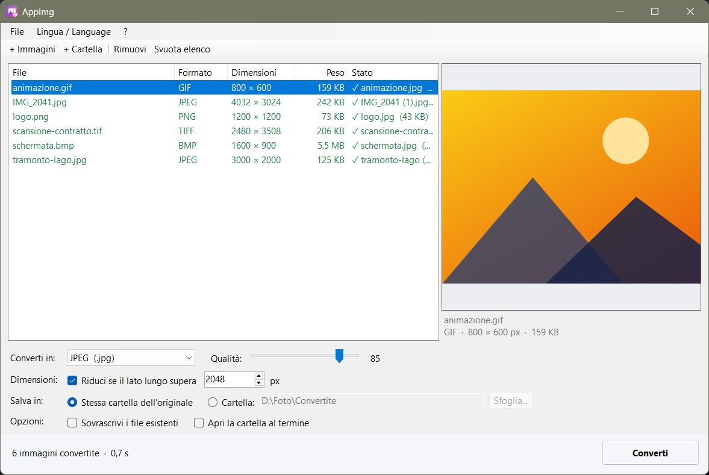
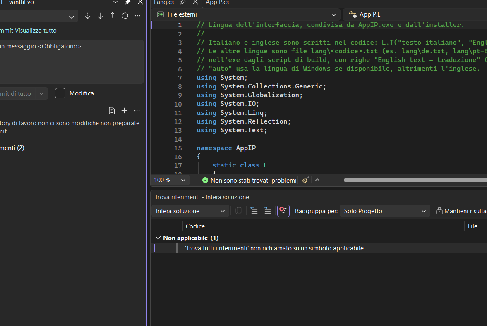

<h1 align="center">AppImg</h1>

<p align="center">
  Convertitore di immagini per Windows: apre JPEG, PNG, HEIC, WebP, AVIF, TIFF, RAW e altri, e salva in PNG, JPEG, WebP, HEIC, TIFF, BMP, GIF, JPEG XR, ICO o PDF. Anche cento file alla volta.<br>
  <a href="#english">English below</a>
</p>

<p align="center">
  <a href="https://github.com/corbolma/AppImg/releases/latest"><b>⬇ Scarica l'ultima versione</b></a> ·
  <a href="https://github.com/corbolma/AppImg/issues">Segnala un problema</a>
</p>

<p align="center">
  
</p>
<p align="center"><sub>Sei immagini di formati diversi convertite in JPEG, ridotte a 2048 px (immagini di esempio)</sub></p>

---

## Italiano

### Cosa fa
- **Legge tutto ciò che Windows sa aprire**: BMP, PNG, JPEG, GIF, TIFF, ICO, JPEG XR e, se hai installato le estensioni gratuite del Microsoft Store, anche **HEIC/HEIF** (foto di iPhone), **WebP**, **AVIF**, **JPEG XL** e i **RAW** delle fotocamere (CR2, CR3, NEF, ARW, DNG, ORF, RW2...).
- **Salva in**: PNG, JPEG, TIFF, BMP, GIF, JPEG XR, **ICO** (icona con tutte le dimensioni da 16 a 256 px) e **PDF** (una pagina per immagine). **WebP** e **HEIC** compaiono nell'elenco se sul PC è installato il relativo encoder.
- **Più file insieme**: trascina immagini o intere cartelle (sottocartelle comprese) nella finestra.
- **Qualità** regolabile per JPEG, JPEG XR e PDF.
- **Riduzione** opzionale: lato lungo massimo in pixel (le immagini più piccole non vengono ingrandite).
- **Foto dritte**: l'orientamento EXIF delle foto del telefono viene applicato, l'immagine convertita non esce girata.
- **Trasparenza** conservata nei formati che la supportano (PNG, TIFF, GIF, ICO, WebP, JPEG XR); negli altri le parti trasparenti diventano bianche.
- **Nessun file perso**: l'originale non viene mai sovrascritto; se il file di destinazione esiste viene creato `foto (1).png`, a meno che tu non scelga *Sovrascrivi i file esistenti*.
- Interfaccia in **italiano e inglese** (segue la lingua di Windows, modificabile dal menu *Lingua / Language*); altre lingue si aggiungono con un semplice file di testo, vedi [lang/README.md](lang/README.md).

### Come si usa
1. Apri AppImg e **trascina** le immagini (o una cartella) nella finestra, oppure usa **+ Immagini** / **+ Cartella**. Da Esplora file puoi anche selezionarle e fare **tasto destro → Invia a → AppImg** (su Windows 11: *Mostra altre opzioni → Invia a*).
2. Scegli il formato in **Converti in**, la qualità e, se vuoi, la riduzione.
3. Scegli dove salvare: nella **stessa cartella** dell'originale o in una **cartella** a scelta.
4. Premi **Converti**. Nella colonna *Stato* trovi il nome e il peso di ogni file creato.

Altro: doppio clic su una riga apre l'immagine; **Canc** toglie le righe selezionate dall'elenco; **Ctrl+V** incolla file copiati in Esplora file; il menu **?** controlla gli aggiornamenti e mostra *Informazioni su AppImg* (versione, autore, licenza e link al progetto).

### Installazione
1. Scarica `AppImg-Setup-X.Y.Z.exe` dalle [Releases](https://github.com/corbolma/AppImg/releases/latest).
2. Avvialo. **Non servono permessi di amministratore**: installa solo per l'utente corrente.
3. Se compare *"Windows ha protetto il PC"*, clicca **Ulteriori informazioni → Esegui comunque** (l'eseguibile non è firmato digitalmente).

Installazione silenziosa (per l'IT): `AppImg-Setup-X.Y.Z.exe /silent` · Disinstallazione: Impostazioni → App, oppure `"%LOCALAPPDATA%\Programs\AppImg\Uninstall.exe" /uninstall /silent`.

**HEIC, WebP, AVIF, RAW**: AppImg usa i codec di Windows. Se un file risulta *Formato non leggibile*, installa dal Microsoft Store l'estensione corrispondente: *Estensioni immagine HEIF* (con *Estensioni video HEVC*), *Estensioni immagine WebP*, *Estensione video AV1*, *Estensione immagini non elaborate (Raw Image Extension)*.

### Aggiornamenti
*? → Controlla aggiornamenti* confronta la versione con l'ultima release su GitHub e, se ce n'è una nuova, la scarica, ne verifica lo SHA-256 e avvia l'installer. Il controllo automatico (una volta al giorno) è disattivato di default.

### Compilare dal sorgente
Non serve installare nulla: si usa il compilatore C# incluso in Windows (.NET Framework 4.x).

```bat
build.bat                      :: crea AppImg.exe
build-installer.bat            :: crea dist\AppImg-Setup-X.Y.Z.exe
build-installer.bat patch      :: incrementa la versione (1.0.0 -> 1.0.1) e crea l'installer
```

### Privacy
AppImg non raccoglie dati e lavora solo sul tuo PC: le immagini non vengono mai inviate da nessuna parte. L'unica connessione esterna è il controllo degli aggiornamenti (`api.github.com`), solo quando lo chiedi tu o se attivi quello automatico. I metadati (EXIF, posizione GPS, ecc.) **non** vengono copiati nei file convertiti.

---

## English

<p align="center"></p>

**AppImg** is a small image converter for Windows 10/11. It opens anything Windows can decode — BMP, PNG, JPEG, GIF, TIFF, ICO, JPEG XR, plus **HEIC/HEIF**, **WebP**, **AVIF**, **JPEG XL** and camera **RAW** files when the free Microsoft Store extensions are installed — and saves to PNG, JPEG, TIFF, BMP, GIF, JPEG XR, **ICO** (multi-size icon, 16–256 px) and **PDF** (one page per image). **WebP** and **HEIC** output appear when the matching encoder is installed.

- Drag images or whole folders (including subfolders) onto the window, use *+ Images* / *+ Folder*, or select files in File Explorer → right-click → **Send to → AppImg**.
- Adjustable quality (JPEG, JPEG XR, PDF), optional downscaling to a maximum long side (never enlarges), EXIF orientation applied so phone photos don't come out rotated.
- Transparency is kept where the format supports it (PNG, TIFF, GIF, ICO, WebP, JPEG XR); otherwise it becomes white.
- The original is never overwritten; existing files get a `photo (1).png` name unless you tick *Overwrite existing files*.
- **Install:** download `AppImg-Setup-X.Y.Z.exe` from [Releases](https://github.com/corbolma/AppImg/releases/latest). Per-user install, no admin rights required. The executable is not code-signed, so SmartScreen may ask you to confirm (*More info → Run anyway*). Silent install: `/silent`.
- **Updates:** *? → Check for updates* downloads the installer from GitHub Releases and verifies its SHA-256. Automatic daily check is off by default.
- **Build:** run `build-installer.bat` — it uses the C# compiler bundled with Windows (.NET Framework 4.x), no SDK needed.
- **Privacy:** no telemetry, images never leave your PC. The only outbound request is the update check (`api.github.com`). Metadata (EXIF, GPS location...) is not copied to converted files.

The user interface is available in **English and Italian**: it follows the Windows display language and can be changed from the menu (*Lingua / Language*).
**Translations are welcome**: adding a language is just a text file, no coding required — see [lang/README.md](lang/README.md).

## License

[MIT](LICENSE) © 2026 Mauro Corboli
